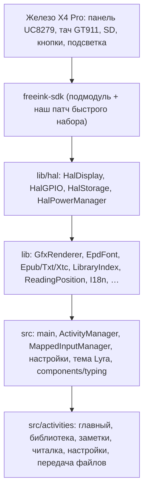

# Как устроена прошивка

Код идёт слоями: железо → FreeInk SDK → HAL → библиотеки → ядро приложения → экраны. Экраны обращаются к железу
только через HAL и ядро. Правила кода — в [AGENTS.md](../../AGENTS.md).

## Модули

| Путь | Что делает |
|---|---|
| `freeink-sdk/` | Драйверы панели, тача, кнопок, питания; FreeInkUI (списки, шапки, диалоги). Наши правки — патч в `scripts/freeink_sdk_patches/`, накладывается при сборке |
| `lib/hal` | Обёртки над SDK. Весь доступ к SD — через `HalStorage` (мьютекс) |
| `lib/GfxRenderer` | Кадровый буфер, текст, фигуры, иконки, вывод на панель |
| `lib/EpdFont` | Встроенные шрифты и шрифты с SD (`.cpfont`, TTF) |
| `lib/Epub`, `lib/Txt`, `lib/Xtc` | Разбор и вёрстка книг, переносы (RU/EN), кэш страниц на SD |
| `lib/LibraryIndex` | Индекс библиотеки на SD, поиск, сортировка |
| `lib/ReadingPosition` | Перевод позиции в книге между страницами и XPath; нужен закладкам и прогрессу |
| `lib/I18n` | Строки интерфейса RU/EN; заголовки генерируются из `translations/*.yaml` при сборке |
| `src/main.cpp` | Загрузка, регистрация шрифтов, главный цикл, сон |
| `src/activities/ActivityManager` | Стек экранов, поток отрисовки, `RenderLock` |
| `src/components/themes/lyra` | Единственная тема (Lyra): шапки, меню, иконки главного экрана |
| `src/components/typing` | Клавиатура, отслеживание пальцев, режим быстрого набора, выделение и буфер обмена — общие для заметок и полей ввода |
| `src/components/SelectionCallout` | Плашка действий у выделенного текста |
| `src/components/icons` | Иконки Lucide. `*.manifest` описывает, как их перегенерировать |
| `src/activities/notes` | Заметки: список, редактор, Markdown, хранение |
| `src/activities/util/KeyboardEntryActivity` | Системное поле ввода на нашей клавиатуре |
| `src/network` | Веб-сервер передачи файлов, OTA с релизов форка |

## Потоки и жизненный цикл экрана

Работают два потока. Цикл ввода (`loop()` экрана) опрашивает кнопки и касания. Поток отрисовки (`render()`) рисует
под `RenderLock`. `ActivityManager` вызывает `onEnter`/`onExit` с удержанной блокировкой, поэтому внутри `onExit`
брать `RenderLock` нельзя: будет взаимная блокировка. Данные между потоками передаются через очередь событий или атомики
(см. `NoteEditorActivity`).

## Заметки

| Файл | Роль |
|---|---|
| `NotesStore` | `/notes/*.md`: список (закреплённые сверху, потом по времени), чтение, атомарная запись через `.tmp`, имя файла из первой строки, закрепления в `/notes/.pinned` |
| `NoteMarkdown` | Разбор Markdown в атрибуты на каждый байт: стиль, скрытая разметка, глифы (маркер, чекбокс, цитата, линия, рамка кода). Покрыт тестами `test/note_markdown` |
| `NoteEditorActivity` | Редактор: очередь событий, перенос строк разной высоты, курсор, прокрутка пальцем, чекбоксы по тапу, панель над клавиатурой, автосохранение |
| `NotesListActivity` | Список с поиском, «+» для новой заметки, меню по удержанию (открыть, закрепить, удалить) |

Абзац с курсором при открытой клавиатуре показывает сырую разметку; остальные — оформленными.

## Шрифты

Встроенный шрифт — Ubuntu: 10 и 12 (обычный и жирный), 12 курсив и жирный курсив, жирный 14 и 16 для заголовков
заметок. Мелкий шрифт строки состояния — Noto Sans 8. Книги — шрифт с карты, который выбрал читатель (например,
Charter); без него — Ubuntu 12. Исходники шрифтов и скрипты конвертации — `lib/EpdFont/builtinFonts/source` и
`lib/EpdFont/scripts`.

## Сборка и проверки

- Прошивка: `~/.platformio/penv313/bin/pio run -e x4pro-gh_release`.
- Тесты на компьютере: `cmake -S test -B build/test && cmake --build build/test && ctest --test-dir build/test`.
- Форматирование: `./bin/clang-format-fix -g`.
- Релиз: пуш тега `*-plus.*` запускает `.github/workflows/release.yml`.
