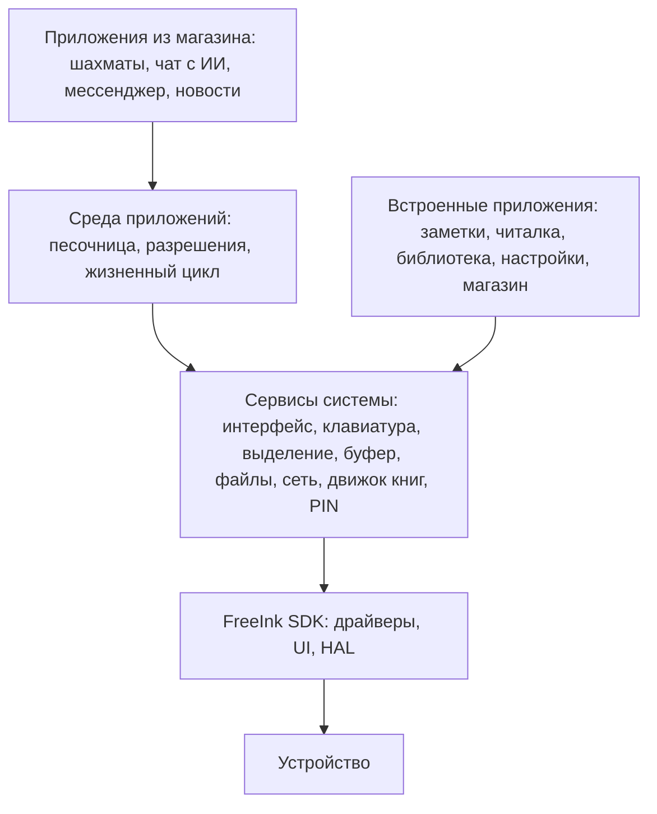

# Платформа: каркас и приложения

Проект развивается из форка CrossPoint в отдельную открытую систему для e-ink устройств: один каркас, на который
приложения ставятся из магазина по Wi‑Fi, без перепрошивки. Работа над читалкой и заметками показала, что приложение
такого уровня можно создать без ручного кода, и это стоит сделать доступным каждому.

Документ описывает цель и архитектуру. Что пока только предположение, отмечено явно. Порядок работ и журнал решений —
в [ROADMAP.md](ROADMAP.md), устройство текущей прошивки — в [ARCHITECTURE.md](ARCHITECTURE.md).

## Цель

Пользователь открывает «Магазин», выбирает приложение, нажимает «Установить» и пользуется. Ни компьютера, ни файлов, ни
понимания, что внутри. Разработчик (или ИИ по описанию) делает приложение, открывает pull request, и после проверки оно
появляется у всех.

Принципы:
1. **Простота важнее возможностей.** Если шаг нельзя объяснить за одну фразу, его не должно быть.
2. **Одна прошивка на всех.** Набор приложений различается, система — нет. Сборщика прошивок не делаем.
3. **Единый стиль задаёт система.** Приложение описывает смысл экрана, а не пиксели.
4. **Чужому коду не доверяем.** Приложение видит только то, что ему разрешили.
5. **Всё открыто.** Код системы, каталог и то, из чего собрано каждое приложение.
6. **Файлы принадлежат пользователю.** Данные — обычные файлы на карте.

## Устройства

Цель — устройства, на которых работает CrossPoint. FreeInk SDK уже закрывает их различия ниже уровня приложений.

| Устройство | Чип | Экран | Ввод |
|---|---|---|---|
| X4 Pro | ESP32-S3, PSRAM | 480×800, ч/б | касание, кнопки |
| X4 | ESP32-C3 | 480×800, ч/б | кнопки |
| X3 | уточнить | уточнить | уточнить |
| M5Stack Paper Mono | ESP32-S3 | 800×480, ч/б | касание |
| M5Stack PaperS3 | ESP32-S3 | 960×540, 16 градаций | только касание |
| M5 PaperColor | ESP32-S3 | цветной ED2208 | уточнить |
| M5Paper | ESP32 | уточнить | уточнить |

Чипы разные (Xtensa и RISC-V), памяти от сотен килобайт до мегабайт PSRAM, экраны и ввод разные. Отсюда три требования:
файл приложения один на все устройства, интерфейс описывается смыслом, манифест объявляет требования.

## Слои



**Встроенные приложения** — нативный код в прошивке. Они используют те же сервисы, но работают напрямую: скорость набора
(~300 мс) и вёрстка книг иначе не сохранятся. Их можно отключить, и они исчезнут с главного экрана.

**Сторонние приложения** — один файл на карте, который выполняется в песочнице.

## Формат приложения

Папка в `/apps` (путь латиницей, как все системные):

```
/apps/org.example.chess/
  app.json      манифест
  app.bin       код (формат определит пробный запуск)
  icon.png      иконка (система приводит её к своему виду)
  data/         данные приложения: только эта папка доступна ему
```

```json
{
  "id": "org.example.chess",
  "name": { "en": "Chess", "ru": "Шахматы" },
  "version": "1.2.0",
  "api": 1,
  "permissions": ["network"],
  "requires": { "touch": false, "keyboard": false, "memoryKb": 256 },
  "settings": [
    { "key": "level", "type": "choice", "title": { "en": "Level", "ru": "Уровень" }, "values": ["easy", "hard"] }
  ]
}
```

`api` — версия контракта с системой. Система поддерживает диапазон версий и не предлагает несовместимые приложения.
`settings` описывает настройки декларативно: раздел в «Настройках» строит система.

## API приложения

Приложение реагирует на события и описывает экран. Система сама раскладывает его под устройство и выбирает обновление
панели, поэтому приложение не знает про пиксели, волны и частичное обновление.

```
onStart()                     запуск
onEvent(event)                action, текст, таймер, ответ сети
render(screen)                описать экран: заголовок, список, текст, кнопка, поле ввода
```

Ввод — смысловой: «выбрать», «назад», «ввести текст». На устройстве с касанием это тап, на кнопочном — фокус и
подтверждение. Для рисования (шахматная доска) будет простой холст; его размер приложение узнаёт у системы.

| Сервис | Что даёт | Разрешение |
|---|---|---|
| Интерфейс | Экраны, списки, диалоги, плашка действий | не нужно |
| Текст | Системная клавиатура, выделение, буфер | не нужно |
| Файлы | Своя папка `data/` | не нужно |
| Сеть | HTTP(S) запросы | `network` |
| Настройки | Значения из манифеста | не нужно |
| Книги | Движок вёрстки, страницы, позиции, выделения | `books` |
| Заметки | Чтение и запись `/notes` | `notes` |
| Защита | PIN при открытии, шифрование `data/` | не нужно |
| Время | Часы, таймеры | не нужно |

Разрешения показываются при установке одной понятной фразой. В первой версии они принимаются целиком.

### Движок книг

Разбор EPUB и вёрстка слишком тяжёлые для песочницы, поэтому это сервис системы. Читалку можно заменить: интерфейс,
жесты, статистика и выделения остаются за приложением. Сам движок меняется только с обновлением системы.

## Песочница

Предварительный выбор — WebAssembly или Lua; решение за пробным запуском ниже. Нативный код (ELF) отбрасываем: файлы под
каждый чип и нет изоляции.

Приложение получает только функции из таблицы выше. Система ограничивает его память, ловит ошибки и закрывает его, не
падая сама. Запущено одно приложение за раз: многозадачности нет, при выходе память освобождается.

Система не поддерживает запуск приложений в фоне: устройство большую часть времени спит.

## Магазин

Без своего бэкенда: публичный GitHub-репозиторий.


1. Автор добавляет в каталог манифест и ссылку на исходники с точным коммитом.
2. CI сам собирает приложение. Файл автора не принимается: то, что ставится, собрано из открытого кода.
3. Человек смотрит разрешения и принимает pull request.
4. Устройство скачивает небольшой `catalog.json`, показывает совместимые приложения.
5. При установке файл проверяется по контрольной сумме; система показывает разрешения.
6. Обновления приложений и системы приходят так же.

Каталог будет подписан ключом проекта, и устройство проверит подпись. На первом шаге достаточно HTTPS и сумм.

## Защита данных

Экран с PIN без шифрования только прячет интерфейс: карту можно вынуть и прочитать. Поэтому защита — сервис системы:
приложение или пользователь включает её для приложения, система спрашивает PIN при открытии и шифрует `data/` ключом из
PIN. Забытый PIN означает потерю данных, и об этом система предупреждает при включении. Защищённые данные недоступны для
передачи файлов и синхронизации, пока приложение заблокировано.

## Сетевые приложения

Сервисы со своим сервером — обычные приложения с разрешением `network`. Два устройства в разных сетях не свяжутся
напрямую, поэтому мессенджер работает через посредника (открытый брокер или свой сервер) и шифрует сообщения: устройства
обмениваются ключами через код или QR. Доставка идёт, когда устройство подключено к Wi‑Fi. Интеграция с домашним
сервером (этап 8) становится приложениями: SilverBullet, статьи, новости.

## Отношения с CrossPoint

Отдельный проект с новым именем, а не форк с ежедневной синхронизацией. Код берём как есть, сохраняя лицензии MIT и
указание авторства CrossPoint и FreeInk. Формат кэша книг и настройки чтения по возможности совместимы, чтобы переход не
требовал потерь. Исправления из CrossPoint переносим вручную. Имя выберем до публичного релиза.

## План

| Шаг | Что | Готово, когда |
|---|---|---|
| 1 | Пробный запуск | Выбран формат приложений по замерам |
| 2 | Каркас | Реестр приложений, манифест, главный экран и настройки строятся из реестра |
| 3 | Перенос | Заметки, читалка, библиотека — приложения на публичных сервисах; «Календарь» написан только через них |
| 4 | SDK | Шаблон, документация, инструкция для ИИ, шахматы как пример |
| 5 | Второе устройство | То же приложение работает на другом экране и вводе без правок |
| 6 | Магазин | Установка и обновление с устройства, каталог и CI |
| 7 | Публичный релиз | Новое имя, установка с нуля, обновление по воздуху |
| 8 | Защита и сетевые приложения | PIN с шифрованием, мессенджер, чат с ИИ |

## Пробный запуск

Вопрос: какой формат приложений тянет всё железо, включая устройства без PSRAM.

| Кандидат | Что проверяем |
|---|---|
| Lua | Рост прошивки, память, скорость, вызовы системы |
| wasm3 | То же; самый лёгкий интерпретатор WebAssembly |
| WAMR | То же; официальный компонент Espressif |

Замеряем на X4 Pro и, если есть устройство, на C3: рост прошивки на каждом чипе, свободную память до и после загрузки,
время загрузки, скорость вычислений, стоимость вызова системы и сбор экрана из 20 строк. Результат — таблица здесь и
запись в журнале решений.

**Критерий выбора:** приложение с экраном из 20 строк загружается меньше чем за секунду и работает в памяти устройства
без PSRAM; при равных результатах берём то, что проще писать людям и ИИ. Пока запуск не завершён, выводы по песочнице
считаются предположением.

Открытые вопросы:
- Хватит ли памяти на C3 рядом с сетью и TLS. Возможно, магазин там будет работать иначе.
- Как устроить холст на панелях с разным обновлением.
- Как переносить данные встроенных приложений при обновлении API.
